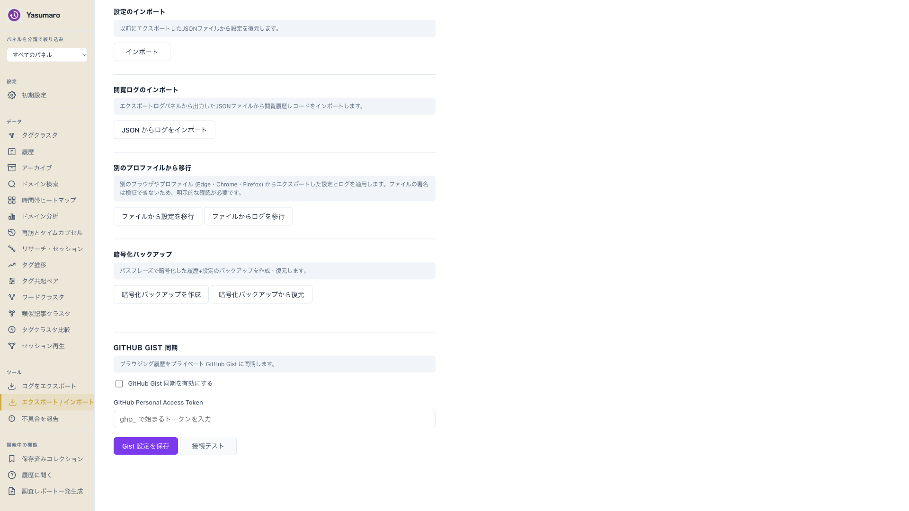
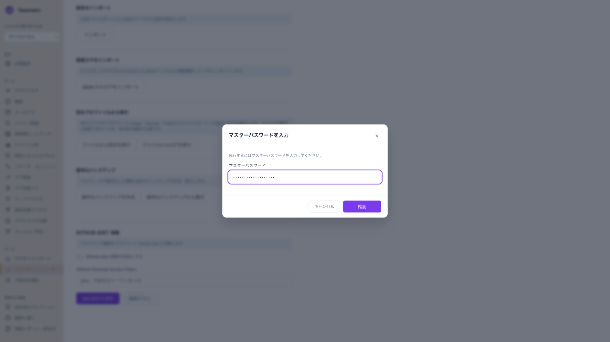
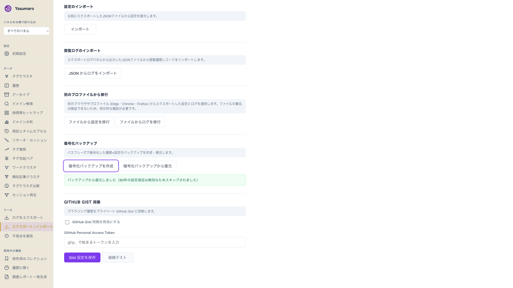

# 暗号化バックアップ ユーザーガイド / Encrypted Backup User Guide

[日本語](#日本語) | [English](#english)

---

## 日本語

### 前提

暗号化バックアップを使うには、マスターパスワードの設定が必要です。バックアップの暗号化と認証の両方に同じ合言葉（パスフレーズ）を使うため、復元する側のブラウザでも**一字一句同じ合言葉**を設定します。

- 対応ブラウザ: Edge・Chrome・Firefox
- ファイル形式: `yasumaro-backup-*.encrypted.json`（AES-GCM で暗号化）
- 復元できるファイルサイズの上限は 50MB です

### 1. マスターパスワードを設定する

1. ダッシュボードで「プライバシー」パネルを開きます。
2. 「マスターパスワード保護」の「マスターパスワードを設定して暗号化」を押します。
3. 12文字以上・大文字/小文字/数字/記号のうち3種類以上を含む合言葉を入れ、確認欄にも同じものを入れて保存します。弱いと足りない条件がそのまま表示されます。

### 2. バックアップを作成する

1. ダッシュボードで「エクスポート / インポート」パネルを開きます。
2. 「暗号化バックアップ」の「暗号化バックアップを作成」を押します。

3. パスワード入力の画面で合言葉を入れ、「確認」を押します。実行中は画面の中で「履歴DBを読み出しています...」→「暗号化しています...」と切り替わり、確認ボタンは「処理中...」になります。

4. 終わるとファイルがダウンロードされ、同じファイル名で完了が表示されます。

### 3. バックアップから復元する

1. 復元するブラウザでも、手順1と同じ合言葉でマスターパスワードを設定します。
2. 「エクスポート / インポート」パネルの「暗号化バックアップから復元」を押し、ファイルを選んで合言葉を入れます。
3. 実行中は「復号しています...」→「履歴DBを復元しています...」→「設定を復元しています...」と切り替わります。
4. 成功すると完了が表示されます。無効な設定項目があった場合は、何件スキップしたか件数つきで出ます（スキップ自体は正常動作です）。

復元はそのブラウザの履歴と設定を上書きします。残したい状態がある場合は、先に「設定のエクスポート」で別保存してください。

### 4. Edge から Chrome へ移す

1. Edge で上記手順1・2を行い、バックアップファイルを作ります。
2. Chrome に同じ拡張機能を入れ、手順1と同じ合言葉を設定します。
3. Chrome で上記手順3を行います。

ファイルの中身は暗号化済みなので、そのまま渡してかまいません。合言葉と同じ場所には置かないでください。

### 困ったときは

| 症状 | 見直す点 |
|---|---|
| 確認を押しても何も変わらない | 古い版を使っています。最新版に更新し、拡張機能の再読み込みとタブのリロードを行ってください |
| 「マスターパスワードが設定されていません」と出る | 先に手順1で設定してください。未設定では認証を通せません |
| 弱い理由が出て保存できない | 12文字以上・3種類以上の文字種を満たす合言葉にしてください |
| 「パスワードが正しくありません」など復号の失敗が出る | 両ブラウザの合言葉が一字一句同じか確認してください |
| 「ファイルが大きすぎます」と出る | 50MBを超えています。履歴を整理して作り直してください |
| 復元で「○件スキップ」と出る | 無効な設定項目を飛ばした正常表示です |
| 段階表示が途中で止まって見える | 重いDBでは数秒かかります。文言が切り替わるまで待ってください |

---

## English

### Requirements

Encrypted backup needs a master password. The same passphrase encrypts the backup and passes authentication, so set **exactly the same passphrase** in the browser you restore to.

- Supported browsers: Edge, Chrome, Firefox
- File format: `yasumaro-backup-*.encrypted.json` (AES-GCM encrypted)
- Restorable file size limit: 50 MB

### 1. Set a master password

1. Open the Privacy panel in the dashboard.
2. Select the link for setting up master password protection.
3. Enter a passphrase with 12 or more characters, using at least 3 of uppercase, lowercase, digits, and symbols. Enter it twice and save. Missing conditions are shown as they are.

### 2. Create a backup

1. Open the Export / Import panel.
2. Select Create encrypted backup.

3. Enter the passphrase and confirm. Stages such as reading the history database and encrypting appear inside the dialog, and the button turns into a busy state.

4. The file downloads, and completion shows the same file name.

### 3. Restore from a backup

1. Set the same passphrase as master password in the restoring browser.
2. Select Restore from encrypted backup, pick the file, and enter the passphrase.
3. Stages for decrypting, restoring the history database, and restoring settings appear.
4. A success message appears. Invalid settings items are skipped with a count, which is normal.

Restoring overwrites that browser's history and settings. Export the current settings first if you want to keep them.

### 4. Move from Edge to Chrome

1. In Edge, follow steps 1 and 2 to create a backup file.
2. In Chrome, install the same extension and set the same passphrase.
3. In Chrome, follow step 3.

The file contents are encrypted. Do not keep it next to the passphrase.

### Troubleshooting

| Symptom | What to check |
|---|---|
| Nothing happens on confirm | Update to the latest version, reload the extension, and reload the tab |
| Master password is not set | Set it first by following step 1 |
| Weak passphrase is rejected | Use 12 or more characters with at least 3 character classes |
| Decryption fails | Both browsers must share the exact same passphrase |
| File is too large | Files over 50 MB are rejected |
| Some items were skipped | Invalid settings items are skipped by design |
| Progress looks stuck | Large databases take seconds; wait for the stage text to change |
