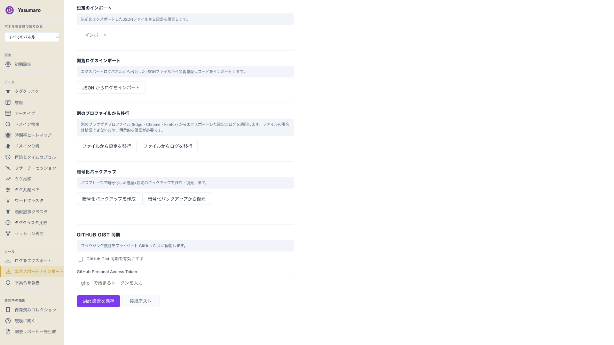
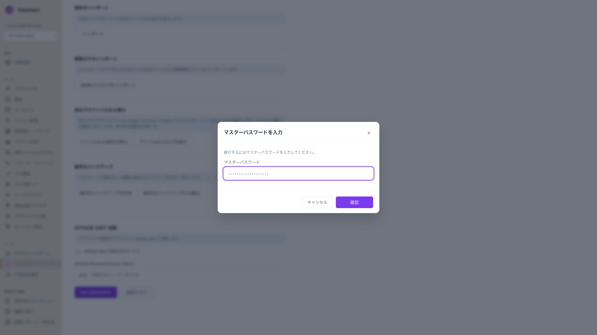
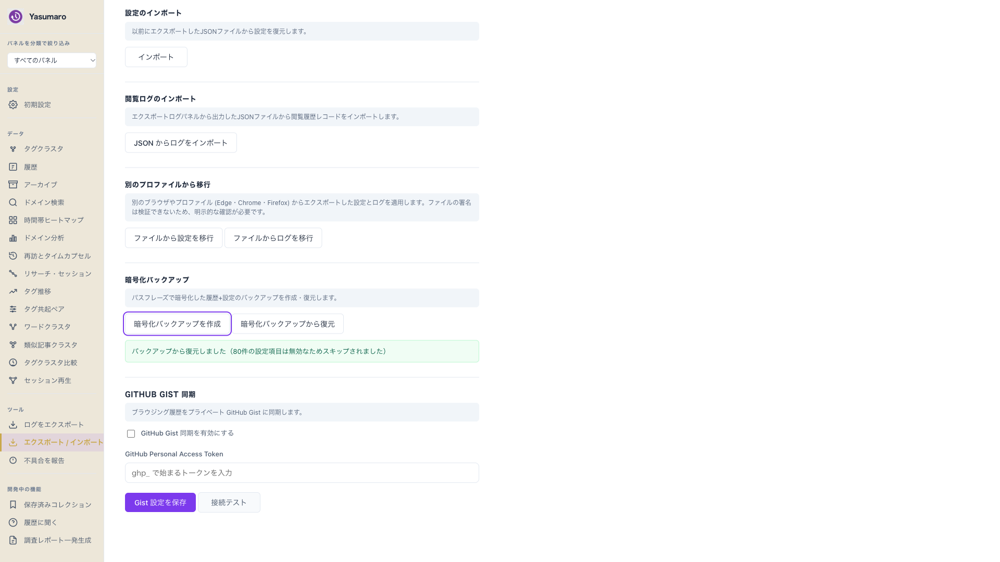

# 暗号化バックアップ ユーザーガイド / Encrypted Backup User Guide

[日本語](#日本語) | [English](#english)

---

## 日本語

### 前提

暗号化バックアップを使うには、マスターパスワードの設定が必要です。バックアップの暗号化と認証の両方に同じ合言葉（パスフレーズ）を使うため、復元する側のブラウザでも**一字一句同じ合言葉**を設定します。

- 対応ブラウザ: Edge・Chrome・Firefox
- ファイル形式（AES-GCM で暗号化）:
  - 単一形式: `yasumaro-backup-*.encrypted.json`
  - 分割形式: `*.manifest.encrypted.json`（マニフェスト）と `*.part-N-of-M.encrypted.json`（パート群）
- 復元時に選択できるバックアップファイル 1 件の大きさの上限は 50MB です

履歴 DB が大きく単一形式 1 件に収まらない場合は、作成時に自動で分割形式になります。形式を選ぶ操作はありません。

### 上限の整理

| 項目 | 上限 |
|---|---|
| 復元時に選択できるバックアップファイル 1 件の大きさ | 50MB |
| 単一形式で作成できるバックアップ 1 件の大きさ | 50MB（超えると作成時に自動で分割形式になります） |
| 分割形式のパート数 | 最大 16 件 |
| 分割形式で作成できる履歴 DB の大きさ | パートを結合した後の大きさが 50MB まで（超えると作成時に案内が出て、作成は行われません） |

- gzip 圧縮が効くため、元の履歴 DB は 50MB より大きくても作成・復元できる場合があります。圧縮率はデータの内容によります
- 作成時に上限超過の案内が出なかったバックアップは、復元でも同じ上限内です

### 1. マスターパスワードを設定する

1. ダッシュボードで「プライバシー」パネルを開きます。
2. 「マスターパスワード保護」の「マスターパスワードを設定して暗号化」を押します。
3. 12文字以上・大文字/小文字/数字/記号のうち3種類以上を含む合言葉を入れ、確認欄にも同じものを入れて保存します。弱いと足りない条件がそのまま表示されます。

### 2. バックアップを作成する

1. ダッシュボードで「エクスポート / インポート」パネルを開きます。
2. 「暗号化バックアップ」の「暗号化バックアップを作成」を押します。

3. パスワード入力の画面で合言葉を入れ、「確認」を押します。実行中は画面の中で「履歴DBを読み出しています...」→「暗号化しています...」と切り替わり、確認ボタンは「処理中...」になります。

4. 終わるとファイルがダウンロードされ、同じファイル名で完了が表示されます。履歴 DB が大きい場合は自動で分割形式になり、マニフェスト 1 件とパート群（最大 16 件）がまとめてダウンロードされます。ブラウザが複数のダウンロードを抑止することがあるため、完了表示のファイル名と件数を手がかりに、すべてのファイルが揃っているか確認してください。

### 3. バックアップから復元する

1. 復元するブラウザでも、手順1と同じ合言葉でマスターパスワードを設定します。
2. 「エクスポート / インポート」パネルの「暗号化バックアップから復元」を押し、ファイルを選びます。単一形式ではそのファイルを 1 件、分割形式ではマニフェストと全パートをまとめて選択します（複数選択可）。順序はマニフェストから復元されるため、選択順序は問いません。
3. パートが欠けている場合は、合言葉を入れる前に欠落しているパート番号つきの案内が出て、復元は行われません。不足がないようファイルを選び直してください。
4. 合言葉を入れます。実行中は「復号しています...」→「履歴DBを復元しています...」→「設定を復元しています...」と切り替わります。
5. 成功すると完了が表示されます。無効な設定項目があった場合は、何件スキップしたか件数つきで出ます（スキップ自体は正常動作です）。

復元はそのブラウザの履歴と設定を上書きします。残したい状態がある場合は、先に「設定のエクスポート」で別保存してください。

### 4. Edge から Chrome へ移す

1. Edge で上記手順1・2を行い、バックアップファイルを作ります。
2. Chrome に同じ拡張機能を入れ、手順1と同じ合言葉を設定します。
3. Chrome で上記手順3を行います。

ファイルの中身は暗号化済みなので、そのまま渡してかまいません。合言葉と同じ場所には置かないでください。分割形式のときは、マニフェストと全パートのすべてを渡してください。

### 困ったときは

| 症状 | 見直す点 |
|---|---|
| 確認を押しても何も変わらない | 古い版を使っています。最新版に更新し、拡張機能の再読み込みとタブのリロードを行ってください |
| 「マスターパスワードが設定されていません」と出る | 先に手順1で設定してください。未設定では認証を通せません |
| 弱い理由が出て保存できない | 12文字以上・3種類以上の文字種を満たす合言葉にしてください |
| 「パスワードが正しくありません」など復号の失敗が出る | 両ブラウザの合言葉が一字一句同じか確認してください |
| 50MB を超える履歴 DB のバックアップを作りたい | 作成時に自動で分割形式になります。分割形式でも、パートを結合した後の大きさが 50MB を超えると作成できません。「この履歴 DB は分割形式でも復元可能な上限を超えています。履歴を整理してから再試行してください。」という案内が出たら、履歴を整理してから再試行してください |
| 復元で「バックアップファイルが大きすぎます」と出る | 選択したファイルのうち 1 件が 50MB を超えています。50MB 以下のファイルだけを選んでください |
| 復元でパートの欠落を示す案内が出る | マニフェストと全パートをまとめて選択してください（複数選択可）。選択順序は問いません。案内のパート番号で不足分を確認し、選び直してください |
| 復元で「○件スキップ」と出る | 無効な設定項目を飛ばした正常表示です |
| 段階表示が途中で止まって見える | 重いDBでは数秒かかります。文言が切り替わるまで待ってください |

---

## English

### Requirements

Encrypted backup needs a master password. The same passphrase encrypts the backup and passes authentication, so set **exactly the same passphrase** in the browser you restore to.

- Supported browsers: Edge, Chrome, Firefox
- File formats (AES-GCM encrypted):
  - Single format: `yasumaro-backup-*.encrypted.json`
  - Split format: `*.manifest.encrypted.json` (manifest) and `*.part-N-of-M.encrypted.json` (parts)
- Size limit per backup file selectable at restore: 50 MB

If the history DB is too large for one single-format file, creation switches to the split format automatically. You do not choose the format yourself.

### Limits

| Item | Limit |
|---|---|
| Size of one backup file selectable at restore | 50 MB |
| Size of one backup file creatable in the single format | 50 MB (larger ones switch to the split format automatically) |
| Number of parts in the split format | Up to 16 |
| History DB size creatable in the split format | Up to 50 MB after the parts are joined (above that, creation is refused with a message) |

- gzip compression helps, so a history DB larger than 50 MB may still be creatable and restorable. The compression ratio depends on the data
- A backup created without the over-limit message stays within the same limits at restore

### 1. Set a master password

1. Open the Privacy panel in the dashboard.
2. Select the link for setting up master password protection.
3. Enter a passphrase with 12 or more characters, using at least 3 of uppercase, lowercase, digits, and symbols. Enter it twice and save. Missing conditions are shown as they are.

### 2. Create a backup

1. Open the Export / Import panel.
2. Select Create encrypted backup.

3. Enter the passphrase and confirm. Stages such as reading the history database and encrypting appear inside the dialog, and the button turns into a busy state.

4. The file downloads, and completion shows the same file name. For a large history DB, creation switches to the split format automatically: one manifest and the parts (up to 16) download together. Browsers may block multiple automatic downloads, so use the file name and count in the completion message to confirm all files are in your download folder.

### 3. Restore from a backup

1. Set the same passphrase as master password in the restoring browser.
2. Select Restore from encrypted backup and pick the files. For the single format, pick that one file; for the split format, pick the manifest together with all part files (multiple selection allowed). Selection order does not matter because the order is restored from the manifest.
3. If parts are missing, a message with the missing part numbers appears before the passphrase prompt and nothing is restored. Re-select the files with no parts missing.
4. Enter the passphrase. Stages for decrypting, restoring the history database, and restoring settings appear.
5. A success message appears. Invalid settings items are skipped with a count, which is normal.

Restoring overwrites that browser's history and settings. Export the current settings first if you want to keep them.

### 4. Move from Edge to Chrome

1. In Edge, follow steps 1 and 2 to create a backup file.
2. In Chrome, install the same extension and set the same passphrase.
3. In Chrome, follow step 3.

The file contents are encrypted. Do not keep it next to the passphrase. In the split format, hand over the manifest and all part files.

### Troubleshooting

| Symptom | What to check |
|---|---|
| Nothing happens on confirm | Update to the latest version, reload the extension, and reload the tab |
| Master password is not set | Set it first by following step 1 |
| Weak passphrase is rejected | Use 12 or more characters with at least 3 character classes |
| Decryption fails | Both browsers must share the exact same passphrase |
| Backing up a history DB over 50 MB | Creation switches to the split format automatically. If the joined size after compression still exceeds 50 MB, creation is refused with a message asking you to organize your history and try again |
| Restore says the backup file is too large | One of the selected files exceeds 50 MB. Select only files of 50 MB or less |
| Restore reports missing parts | Select the manifest together with all part files (multiple selection allowed). Selection order does not matter; check the missing part numbers in the message |
| Some items were skipped | Invalid settings items are skipped by design |
| Progress looks stuck | Large databases take seconds; wait for the stage text to change |
