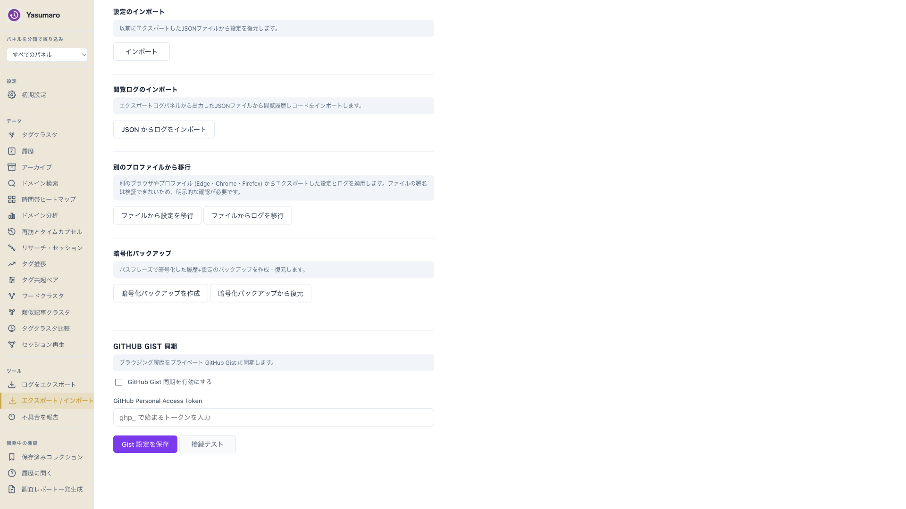
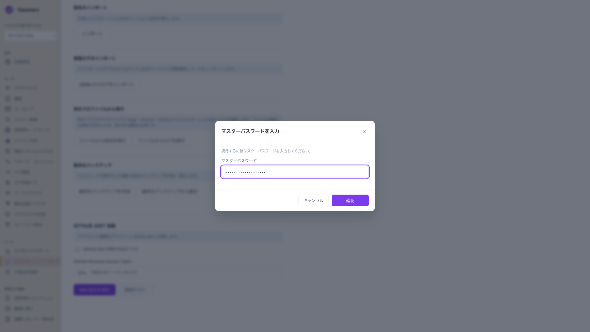
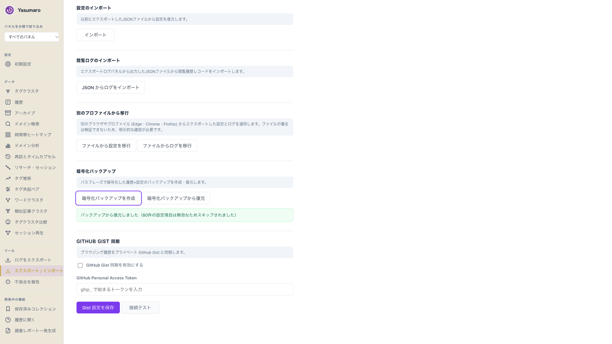

<!--
下書きメモ（公開前に削除）
- 版数根拠: package.json 6.9.69 ＋ CHANGELOG Unreleased 差分を源泉に執筆。リリース日がずれたら slug と title の版数を合わせる
- リリースノートURL: 版数タグ確定後に追記すること（現時点で材料なしのため省略）
- 初見向けドキュメントURL: GitHub Pages の公開 URL が材料にないため省略。確定後に追記
- Issues URL は https://github.com/armaniacs/yasumaro/issues を記載（リポジトリ名からの定型派生。要確認）
- 画像: promo/2026-11-06-v6.9.69/images/ の4枚＋promo.mp4（15秒）を使う。本文は相対パス参照
- published: true にする条件: 版数・URL・画像の目視確認が済んだら
- 質問キャンセル時の仮置き: 読者=現ユーザー、行動=試用、体験談=今回の実話を使用
-->

Yasumaro の v6.9.69 をリリースしました。履歴と設定を持ち運ぶ周りがまとまって直っています。利用者に見える変更は4つです。

- 暗号化バックアップに進行表示がつき、ファイル名の予告・確認が出る
- Edge・Chrome・Firefox間のプロファイル移行モードができた
- マスターパスワード設定で弱い理由がそのまま表示される
- uBlock由来の設定エクスポート肥大（28MB級）を解消した

<!-- GIF 位置: images/promo.mp4（15秒。作成→復元の流れ） -->

## バックアップが今どこまで進んだか分かる

エクスポート/インポートの「暗号化バックアップを作成」を押すと、パスワード入力のモーダルの中で段階が切り替わります。履歴DBの読出し、暗号化、復号、履歴DBの復元、設定の復元の5段階です。確認ボタンは押した瞬間に「処理中...」へ変わり、入力欄は無効化されます。二重押しも無視されるので、重いDBで固まったように見えて連打しても二重実行になりません。

作成開始時にはファイル名を予告し、終わったら同じ名前で完了が出ます。

<!-- GIF 位置: 上の画面で「暗号化バックアップを作成」を押す場面。なければ promo.mp4 で代用 -->

状況と今の振る舞いの対応はこうです。

| 状況 | 振る舞い |
|---|---|
| 作成・復元の実行中 | モーダル内に段階文言＋「処理中...」が出る |
| パスワードが違う | モーダルを開けたまま理由を残す。背後の設定は変わらない |
| 復元で一部設定が無効 | 何件スキップしたか件数つきで成功表示が出る |

裏側の話を少しだけ書きます。確認ボタンが押せているように見えて何も起きない、という報告がありました。原因は認証モーダルのリスナー登録がプライバシーパネルを開いたときにしか走らず、パネルが遅延マウント方式だったことです。直行でバックアップ画面を開くとボタンが死んでいました。今はエクスポート/インポート側のマウントでも登録し、二重登録防止ガードを入れています。同じ画面で「押しても何も起きない」系の不具合は、まず開いたパネルの順番を疑うと切り分けが速いです。

## Edge・Chrome・Firefox間で設定とログを移せる

エクスポート/インポートに移行セクションができました。Edge・Chrome・Firefoxの全9通りの組み合わせに対応します。移行時は署名検証の代わりに明示確認ダイアログを経ます。確認でキャンセルすれば無変更、成功すれば監査ログに残ります。通常インポートの拒否動作は変わりません。

普段使いのEdgeで作った暗号化バックアップをテスト用のChromeへ復元する使い方ができます。条件は1つだけで、両ブラウザのマスターパスワードを一字一句同じにすることです。暗号化と認証の両方に同じパスフレーズを使うため、違うと復号できません。

## 弱いパスワードの理由が読める

マスターパスワード設定で弱いと、以前は「8文字以上である必要があります」とだけ出ていました。実際のポリシーは12文字以上・大文字/小文字/数字/記号のうち3種以上・一定以上の強度なので、噛み合わない文言が混乱を招いていました。今は判定理由をそのまま出します。保存処理の失敗もモーダルの中に表示され、背後の画面の文言を探さなくて済みます。前回失敗の古いエラーは次の確定時に消えます。

## 設定エクスポートが28MBに膨らむ問題を直した

uBlockフィルタのドメイン集合がソース側とマージ済みルール側に二重保存され、設定のエクスポートが28MBまで膨らみ10MiB上限に当たる不具合がありました。マージ済みルールの永続化を止め、ソースからの導出に一本化しています。旧来の二重データは読み取り時に正規化されるので、利用者側の操作は不要です。設定は10KB級に戻ります。

## 開発基盤の変更

今回の利用者向け修正にひもづく回帰テストを追加しています（転送・保持・二重登録防止・文言置換）。利用者に見える挙動の追加はありません。

## 入れ方

- 配布: https://chromewebstore.google.com/detail/yasumaro-ai-browsing-logg/cpeammcnmfpmlkidciiobmnjhfkmjlc
- すでに入れている方は更新されます。ストア版は審査を経るため GitHub Releases の最新より反映が遅れる場合があります

「困ったこと・欲しいこと」は画面のURLと一緒にIssueで教えてください。

https://github.com/armaniacs/yasumaro/issues
